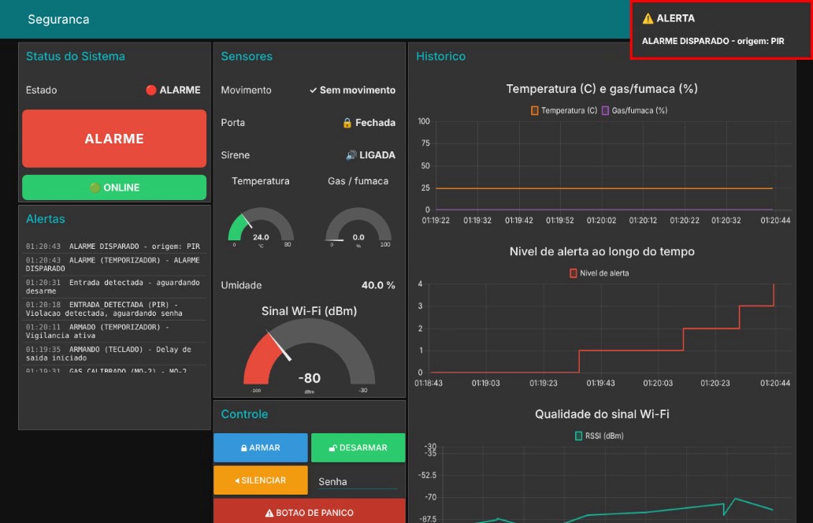
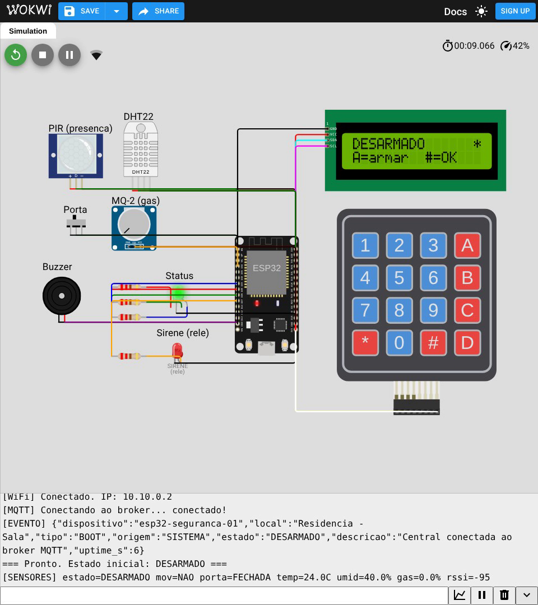

# Sistema de Segurança Residencial IoT

Projeto IoT desenvolvido com **ESP32**, **PlatformIO**, **MQTT**, **Node-RED** e **Dashboard**, simulado no **Wokwi**.

Uma central de alarme completa: detecta presença, abertura de porta, gás/fumaça e temperatura alta (incêndio), exige senha para armar/desarmar, dispara sirene, publica tudo por MQTT e é monitorada e controlada remotamente por um dashboard web.

---

## Descrição do problema

Arrombamentos em residências e pequenos comércios costumam acontecer quando não há ninguém no local. Alarmes convencionais fazem barulho, mas não avisam o dono nem registram o que aconteceu: se o morador está longe, só descobre a invasão ao voltar. Além disso, sistemas fechados de mercado exigem mensalidade de monitoramento e não permitem nenhuma customização.

## Objetivo

Construir uma central de alarme conectada, de baixo custo, que:

- detecte invasões por **presença** e por **abertura de porta/janela**;
- detecte **incêndio e vazamento de gás** (temperatura e gás/fumaça) a qualquer hora, mesmo desarmada;
- permita **armar e desarmar por senha** num teclado físico, com delays de saída e entrada;
- dispare **sirene, buzzer e sinalização visual** automaticamente;
- envie **estado, leituras, alertas e log de eventos** por MQTT em tempo real;
- seja **monitorada e comandada remotamente** por um dashboard;
- detecte a **queda da própria comunicação** e avise o operador.

---

## Arquitetura do sistema

```
   SENSORES                CENTRAL              REDE            SERVIDOR            USUARIO
 ------------          ---------------      -----------      --------------      -------------
  PIR (D13) ------>|
  Reed (D14) ----->|    +-----------+        MQTT/TCP        +------------+       +---------+
  DHT22 (D23) ---->|
  MQ-2  (D34) ---->|
  Teclado 4x4 ---->|--->|   ESP32   |=====>  porta 1883 =====>|   Broker   |<====>| Node-RED|
                   |    | Maquina de|        Wi-Fi           |  shiftr.io |       |  (flow) |
  ATUADORES        |    |  estados  |                        +------------+       +----+----+
  Buzzer (D12) <---|    +-----------+                                                  |
  Rele   (D27) <---|          |                                                        v
  LED RGB(25/26/33)<--        | I2C                                              +-----------+
                              v                                                  | Dashboard |
                        LCD 16x2 (0x27)                                          |   web     |
                                                                                 +-----------+
```

**Fluxo de dados:** o ESP32 lê os sensores e o teclado, roda a máquina de estados localmente (o alarme funciona mesmo sem internet) e publica estado, telemetria, alertas e eventos no broker MQTT. O Node-RED assina esses tópicos, aplica regras de automação, alimenta o dashboard e publica comandos de volta no tópico `.../comando`.

---

## Lista de componentes

| Componente | Modelo | Pino no ESP32 | Função |
|---|---|---|---|
| Microcontrolador | ESP32 DevKit v1 | — | Processamento, Wi-Fi e MQTT |
| Sensor de presença | PIR HC-SR501 | D13 | Detecta movimento no ambiente |
| Sensor de abertura | Reed switch | D14 (`INPUT_PULLUP`) | Detecta porta/janela aberta |
| Sensor de temperatura | DHT22 | D23 | Temperatura e umidade (detector térmico de incêndio) |
| Sensor de gás/fumaça | MQ-2 (no Wokwi: potenciômetro) | D34 (ADC1, saída analógica) | Vazamento de gás e fumaça |
| Teclado | Membrana 4x4 | D19, D18, D5, TX2, RX2, D4, D2, D15 | Senha de armar/desarmar |
| Buzzer | Piezoelétrico | D12 (LEDC/PWM) | Alarme sonoro local e bipes |
| Sirene | Módulo relé 5 V | D27 | Aciona a sirene externa |
| LED RGB | Cátodo comum | D25 / D26 / D33 | Status visual do sistema |
| Display | LCD 16x2 I2C (0x27) | D21 (SDA) / D22 (SCL) | Interface local |

> No Wokwi o **reed switch** é representado por uma chave deslizante e o **relé** por um LED vermelho rotulado `SIRENE`, já que a plataforma não simula a carga externa. O **MQ-2** é representado por um potenciômetro ligado no mesmo pino analógico: testado no Wokwi, o modelo `wokwi-gas-sensor` não altera a saída quando o `ppm` muda, então não serviria para demonstrar o alarme de gás. Girar o potenciômetro equivale a aumentar a concentração de gás; no hardware real basta ligar a saída AOUT do MQ-2 (alimentado em 3,3 V) no D34. A temperatura é ajustada no slider do DHT22.

---

## Estados do sistema

| Estado | LED | O que acontece |
|---|---|---|
| `DESARMADO` | Verde fixo | Sensores ignorados |
| `SAINDO` | Azul piscando + bipes | Delay de saída de 15 s |
| `ARMADO` | Azul lento | Vigilância ativa |
| `ENTRANDO` | Vermelho piscando + bipes | Violação detectada, 10 s para digitar a senha |
| `ALARME` | Vermelho rápido | Sirene e buzzer bitonal acionados |
| `BLOQUEADO` | Amarelo piscando | Teclado travado por 30 s após 3 erros; volta ao estado anterior (armado continua vigiando) |

---

## Tópicos MQTT

Base: `fatec/seguranca/casa01`

| Tópico | Direção | Retained | Payload |
|---|---|---|---|
| `.../status` | ESP32 → | sim | `DESARMADO` \| `SAINDO` \| `ARMADO` \| `ENTRANDO` \| `ALARME` \| `BLOQUEADO` |
| `.../sensor/movimento` | ESP32 → | não | `DETECTADO` \| `LIVRE` |
| `.../sensor/porta` | ESP32 → | não | `ABERTA` \| `FECHADA` |
| `.../sensor/temperatura` | ESP32 → | não | Temperatura em °C, ex.: `24.0` |
| `.../sensor/gas` | ESP32 → | não | Nível de gás/fumaça em %, ex.: `8.3` |
| `.../alerta` | ESP32 → | não | Texto do alerta |
| `.../evento` | ESP32 → | não | JSON com `tipo`, `origem`, `estado`, `descricao`, `uptime_s` |
| `.../telemetria` | ESP32 → | não | JSON com `estado`, `movimento`, `porta`, `sirene`, `temperatura`, `umidade`, `gas`, `rssi`, `uptime_s` |
| `.../conexao` | ESP32 → | sim | `online` \| `offline` (via **Last Will**) |
| `.../comando` | → ESP32 | não | `ARMAR` \| `DESARMAR:<senha>` \| `SILENCIAR` \| `PANICO` \| `TESTE` |

---

## Eventos e ações automáticas

| Condição | Ação automática |
|---|---|
| Movimento com sistema `ARMADO` | Entra em `ENTRANDO`, publica alerta, inicia contagem de 10 s |
| Porta aberta com sistema `ARMADO` | Mesma ação acima |
| Delay de entrada esgotado sem senha | Dispara `ALARME`: relé + buzzer + LED vermelho + alerta MQTT |
| Senha correta | Desarma (ou arma, se estava desarmado) e atualiza o dashboard |
| 3 senhas incorretas (teclado ou dashboard) | Entra em `BLOQUEADO` por 30 s e publica alerta de tentativa de invasão |
| 3 senhas incorretas durante `ENTRANDO` | Dispara o `ALARME` na hora (o bloqueio não pode ser usado para pausar a contagem) |
| PIR ou porta durante `BLOQUEADO` (armado) | Dispara o `ALARME` direto, já que o teclado está travado |
| Temperatura ≥ 57 °C | Alarme de **incêndio** em qualquer estado (zona 24 h) |
| Gás/fumaça 35 pontos acima da referência | Alarme de **gás/fumaça** em qualquer estado (zona 24 h) |
| Temperatura ≥ 45 °C ou gás 20 pontos acima | Pré-alerta no dashboard, sem sirene |
| Sirene ligada por 60 s | Corta a sirene automaticamente, mas mantém o estado de alarme |
| Botão de pânico (teclado `B` ou dashboard) | Dispara o alarme imediatamente |
| Sem heartbeat por 10 s | Node-RED marca o dispositivo como **OFFLINE** e notifica |
| `ALARME` ativo por mais de 30 s | Node-RED gera alerta de **escalonamento** para o responsável |

---

## Dashboard

O dashboard (Node-RED Dashboard, em `/ui`) entrega os seis itens exigidos:

- **Valores dos sensores** — movimento, porta, sirene, temperatura, umidade, gás/fumaça e sinal Wi-Fi
- **Gráfico de dados** — temperatura e gás, nível de alerta e qualidade do sinal ao longo do tempo
- **Status dos dispositivos** — badge colorido com o estado atual da central
- **Alertas** — notificações em tempo real e histórico das últimas 12 ocorrências
- **Controle de atuador** — botões `ARMAR`, `DESARMAR`, `SILENCIAR` e `PÂNICO`
- **Status da comunicação** — indicador ONLINE/OFFLINE com watchdog independente



---

## Vídeo da demonstração

[`docs/video/sistema-seguranca-iot-demo.mp4`](docs/video/sistema-seguranca-iot-demo.mp4) (3 min 34 s): compilação no PlatformIO, fluxo do Node-RED e o sistema rodando ao vivo no Wokwi com o dashboard e as mensagens MQTT lado a lado: boot, armar pelo teclado, invasão pelo PIR, alarme, silenciar e desarmar pelo dashboard, porta, incêndio (DHT22), gás (MQ-2), bloqueio por senha, pânico, escalonamento e queda de comunicação (OFFLINE).



## Testes automatizados (Wokwi CLI)

`test/porta-e-senha.yaml` testa a porta aberta com o sistema armado e as 3 senhas erradas durante a entrada. Os comandos chegam por MQTT pelo script `test/comandos-mqtt.js`, que faz o papel do dashboard:

```bash
pio run
node test/comandos-mqtt.js &          # precisa do pacote mqtt (npm i mqtt)
wokwi-cli --scenario test/porta-e-senha.yaml --timeout 290000 .
```

Os logs do Monitor Serial dos testes estão em `docs/evidencias/`.

---

## Como executar

**Projeto no Wokwi:** https://wokwi.com/projects/478725460238901249

### 1. Simulação (Wokwi + PlatformIO)

```bash
# compilar o firmware
pio run

# abrir o projeto no VS Code com a extensao Wokwi
# e iniciar a simulacao (o diagram.json ja esta pronto)
```

No Wokwi use obrigatoriamente a rede `Wokwi-GUEST` com senha vazia — já está configurado em `include/config.h`.

Para o editor web do Wokwi, `wokwi-web/sketch.ino` traz `src/main.cpp` e `include/config.h` num arquivo só, e `wokwi-web/libraries.txt` lista as bibliotecas. Se mudar o firmware, gere o arquivo de novo antes de colar no site.

### 2. Node-RED

```bash
npm install -g node-red
node-red-start   # ou apenas: node-red
```

Instale o dashboard em **Menu → Manage palette → Install → `node-red-dashboard`**, depois importe o arquivo `node-red/flows.json` em **Menu → Import**.

Acesse o painel em `http://localhost:1880/ui`.

### 3. Broker MQTT

O projeto usa a instância pública do shiftr.io (`public.cloud.shiftr.io:1883`, usuário `public`, senha `public`), que também aceita WebSocket seguro na porta 443 (`wss://public.cloud.shiftr.io`) para redes que bloqueiam a 1883. O usuário/senha já vêm no `flows.json`. Para trocar por um Mosquitto local, altere `MQTT_BROKER`/`MQTT_USER`/`MQTT_PASS` em `include/config.h` e o nó `HiveMQ Publico` no Node-RED.

### 4. Testando pelo terminal

```bash
# acompanhar tudo que o dispositivo publica
mosquitto_sub -h public.cloud.shiftr.io -u public -P public -t 'fatec/seguranca/casa01/#' -v

# armar o sistema remotamente
mosquitto_pub -h public.cloud.shiftr.io -u public -P public -t 'fatec/seguranca/casa01/comando' -m 'ARMAR'
```

---

## Uso do teclado

| Tecla | Função |
|---|---|
| `0`–`9` | Digita a senha (padrão `1234`) |
| `#` | Confirma a senha |
| `*` | Limpa a digitação |
| `A` | Arma o sistema sem senha |
| `B` | Botão de pânico |

---

## Estrutura do repositório

```
.
├── platformio.ini          Configuração do PlatformIO e bibliotecas
├── diagram.json            Circuito do Wokwi
├── wokwi.toml              Integração PlatformIO + Wokwi
├── include/
│   └── config.h            Pinos, senha, tempos, broker e tópicos
├── src/
│   └── main.cpp            Firmware: máquina de estados e MQTT
├── node-red/
│   └── flows.json          Fluxo e dashboard prontos para importar
├── test/
│   ├── porta-e-senha.yaml  Cenário de teste do Wokwi CLI
│   └── comandos-mqtt.js    Envia os comandos MQTT durante o cenário
└── docs/
    ├── 01-definicao-requisitos.txt
    ├── 02-arquitetura.md
    ├── 03-eventos.md
    ├── Roteiro_Projeto_IoT_Sistema_Seguranca.docx   Roteiro da atividade preenchido
    ├── img/                Prints do Wokwi, Node-RED, dashboard e MQTT
    ├── video/              Vídeo da demonstração
    └── evidencias/         Logs do Monitor Serial dos testes
```

---

## Ambiente real de uso

Residências térreas e pequenos comércios. O PIR cobre a área interna principal (sala ou corredor de entrada), o reed switch fica na porta principal ou na janela mais vulnerável, o MQ-2 fica na cozinha (perto do botijão) e o DHT22 no teto do ambiente principal, e o teclado com LCD é instalado ao lado da entrada, como num painel de alarme comercial.

## Custo estimado

O protótipo completo sai por aproximadamente **R$ 200,00**. Como produto real seriam necessários gabinete próprio, sirene externa robusta, bateria de backup e eventualmente conectividade celular para redundância, elevando o custo para a faixa de **R$ 300,00 a R$ 400,00** por unidade — ainda bem abaixo dos sistemas monitorados de mercado, que cobram mensalidade.

## Conclusão

O projeto mostra que é viável montar uma central de alarme conectada e auditável com componentes de baixo custo. A decisão de manter toda a lógica crítica dentro do ESP32, usando o MQTT apenas como camada de telemetria e comando, garante que o alarme continue protegendo o imóvel mesmo com a internet fora do ar — e o watchdog no Node-RED assegura que essa queda não passe despercebida.
